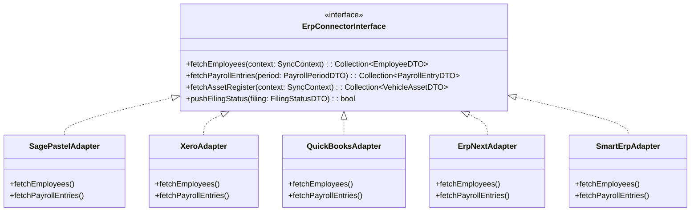

# ZimComply AI — API Integrations & Adapter Architecture

*Document Version:* 1.0.0  
*Phase:* Phase 0 Architecture Baseline  
*Status:* Authoritative

---

## 1. Integration Philosophy & Boundaries

1. **ERP Independence:** ZimComply AI operates autonomously as a standalone compliance platform. It does not require any external ERP or accounting software to function.
2. **Adapter Pattern with Strict DTOs:** Integrations with accounting systems (Pastel, Sage, Xero, QuickBooks, ERPNext, Smart ERP) are decoupled via typed Data Transfer Objects (DTOs) and standardized adapter interfaces.
3. **Database Isolation:** External systems never connect directly to the ZimComply AI operational PostgreSQL database. All data exchanges occur via versioned REST APIs, webhook payloads, or idempotent import jobs.
4. **Regulator Realism:** Government portals (ZIMRA TaRMS, PRAZ e-GP, NSSA) are treated as manual upload destinations or file-based exchanges until certified official direct APIs are opened and verified.

---

## 2. ERP Connector Architecture

### 2.1 Supported ERP Connectors

| System | Connection Mode | Ingestion Scope | Status |
|---|---|---|---|
| **Sage Pastel Partner / Evolution** | CSV Template / SDK Sync Agent | Employees, Wages, General Ledger Accounts | Phase 7 |
| **Xero** | OAuth 2.0 Cloud REST API | Employees, Monthly Payroll Totals | Phase 7 |
| **QuickBooks Online** | OAuth 2.0 Cloud REST API | Employee Directory, Wage Expenses | Phase 7 |
| **ERPNext** | Token-based REST API | Payroll Entries, Fixed Assets (Vehicles) | Phase 7 |
| **Smart ERP (Optional)** | Versioned JSON REST Adapter | Client Entities, Wages, Compliance Ledger | Phase 7 (No operational DB sharing) |

---

## 3. Spreadsheet & Batch Import Pipeline (Excel / CSV)

For SMEs and accounting bureaus operating on spreadsheets:

1. **Standardized Downloadable Templates:**
   - `zimcomply_payroll_template_v1.xlsx` (Employee details, basic wage, allowances, currency splits).
   - `zimcomply_fleet_template_v1.xlsx` (Registration numbers, chassis, licence expiry dates, insurance cover).
   - `zimcomply_licence_register_v1.xlsx` (Council licences, fire safety certificates, health certificates).
2. **Idempotent Ingestion Engine:**
   - Every uploaded row is hashed into a `row_fingerprint` (`sha256(employee_national_id + period_year + period_month)`).
   - If an import job is executed twice, duplicate rows are detected and skipped without mutating existing records.
3. **Dry-Run Validation:**
   - The engine validates header mappings, currency values, and statutory syntax before committing transactions to the database.
   - Comprehensive error reports indicate exact spreadsheet row numbers and validation failure explanations.

---

## 4. Government Portal Integration Strategy

### 4.1 ZIMRA TaRMS (Tax & Revenue Management System)
- **Current Mode:** Structured dossier preparation and official CSV export.
- **Export Formats:**
  - ZIMRA P2 PAYE Monthly Schedule (CSV format adhering to TaRMS specification).
  - ITF12 Annual Corporate Income Tax computation pack (PDF/Excel).
  - Withholding Tax reconciliation schedule.
- **Verification:** User uploads official TaRMS receipt PDF; system parses reference number and updates ITF263 readiness.

### 4.2 NSSA Self-Service Portal
- **Current Mode:** Automated generation of NSSA P4 Form and Monthly Contribution Upload Sheet.
- **Export Formats:** Official NSSA Excel monthly return formatted with Social Security Numbers, gross wage, POBS deduction, and APWCS risk grade.
- **Verification:** User uploads NSSA payment confirmation or clearance certificate.

### 4.3 PRAZ e-GP Portal (Public Procurement)
- **Current Mode:** Document compilation and readiness verification.
- **Features:** Compiles all required bidding artifacts into a single indexed PDF portfolio.
- **Tender Notice Ingestion:** Ingests publicly published procurement notices from official gazettes and tender feeds.

---

## 5. Zimbabwean Payment Gateway Connectors

ZimComply AI integrates with licensed Zimbabwean payment platforms to track regulatory payment evidence:

| Gateway | Currency | Payment Methods | Integration Standard |
|---|---|---|---|
| **Paynow Zimbabwe** | USD / ZiG | EcoCash, OneMoney, Visa/Mastercard, ZimSwitch | Server-to-Server REST API + Instant Payment Notification (IPN) |
| **EcoCash Express** | USD / ZiG | Mobile Wallet Push USSD | EcoCash Merchant API |
| **InnBucks** | USD | Retail Cash Deposit & App Transfer | InnBucks Merchant API |

*Payment Safety:* ZimComply AI records proof of payment references and reconciles bank statements; it does not trigger autonomous withdrawals without explicit user approval.

---

## 6. Outbound Webhook & Event Notification API

ZimComply AI dispatches outbound webhook notifications to external client systems when compliance events occur:

### 6.1 Event Catalog
- `compliance.obligation.expiring` (Triggered at 30, 14, 7 days before expiry)
- `compliance.document.verified` (Triggered when an admin verifies an uploaded certificate)
- `compliance.filing.acknowledged` (Triggered when filing reference is logged)
- `tender.opportunity.matched` (Triggered when a tender matching user PRAZ categories is published)

### 6.2 Security & Signature Verification
- Payloads are signed using an HMAC-SHA256 signature passed in the `X-ZimComply-Signature` header:
  $$\text{Signature} = \text{HMAC-SHA256}(\text{payload\_json}, \text{webhook\_secret})$$
- Recipients verify the cryptographic signature before processing the event.
