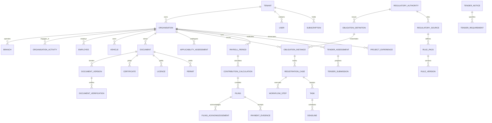

# ZimComply AI — Entity Relationship Diagram & Database Schema Specification

*Document Version:* 1.0.0  
*Phase:* Phase 0 Architecture Baseline  
*Status:* Verified & Authoritative

---

## 1. Domain Groupings & Overview

The ZimComply AI data architecture models multi-tenant compliance lifecycle entities across 9 cohesive sub-domains:

1. **Identity, Multi-Tenancy & Access Control (M01)**: Tenant, Organisation, Branch, User, Role, Permission, Membership, Subscription.
2. **Statutory Rules & Regulatory Knowledge (M02, M12)**: RegulatoryAuthority, Jurisdiction, RegulatorySource, RulePack, RuleVersion, ObligationDefinition, RegulatoryChangeProposal.
3. **Registration Discovery & Roadmap Engine (M02)**: OrganisationActivity, ApplicabilityAssessment, ObligationInstance, RegistrationCase, WorkflowTemplate, WorkflowStep, Prerequisite, Task, Deadline.
4. **Compliance Wallet & Document Intelligence (M09)**: Document, DocumentVersion, DocumentVerification, Certificate, Licence, Permit.
5. **Human Resources, NEC & Sector Agreements (M04, M05)**: Employee, EmployeeClassification, CollectiveAgreement, MedicalAidScheme, MembershipRecord.
6. **Payroll & Statutory Contribution Accounting (M04, M13)**: PayrollImport, PayrollPeriod, ContributionCalculation, Filing, FilingAcknowledgement, PaymentEvidence.
7. **Fleet, Assets & Operational Licensing (M08, M06, M07)**: Vehicle, InsurancePolicy.
8. **Public Procurement & Tender Intelligence (M11)**: ProcurementCategory, SupplierRegistration, TenderNotice, TenderRequirement, TenderAssessment, TenderSubmission, ProjectExperience.
9. **System Operations, Integrations & Audit (M10, M14)**: IntegrationConnection, ImportJob, Approval, ComplianceEvent, Notification, AuditEvent.

---

## 2. High-Level Entity Relationship Diagram (Mermaid)

---

## 3. Detailed Entity Definitions & Data Dictionaries

### 3.1 Identity, Multi-Tenancy & Access Control (M01)

#### `tenants`
Primary boundary of isolation.
- `id`: UUID (Primary Key)
- `name`: VARCHAR(255) (e.g., "Apex Holdings Group", "Alpha Accounting Partners")
- `type`: ENUM ('SME', 'ENTERPRISE', 'ACCOUNTING_FIRM')
- `status`: ENUM ('TRIAL', 'ACTIVE', 'PAST_DUE', 'CANCELLED', 'SUSPENDED')
- `trial_ends_at`: TIMESTAMP NULL
- `created_at`, `updated_at`: TIMESTAMP

#### `organisations`
Legal corporate entities belonging to a tenant.
- `id`: UUID (Primary Key)
- `tenant_id`: UUID (FK -> `tenants.id`, indexed)
- `legal_name`: VARCHAR(255) NOT NULL
- `trading_name`: VARCHAR(255) NULL
- `entity_type`: ENUM ('PRIVATE_LIMITED_COMPANY', 'PBC', 'PARTNERSHIP', 'SOLE_PROPRIETORSHIP', 'TRUST', 'FOREIGN_BRANCH')
- `tin`: VARCHAR(50) NULL (Tax Identification Number, encrypted)
- `incorporation_number`: VARCHAR(100) NULL
- `incorporation_date`: DATE NULL
- `base_currency`: VARCHAR(3) DEFAULT 'USD'
- `fiscal_year_end_month`: SMALLINT DEFAULT 12 (1 to 12)
- `primary_email`: VARCHAR(255)
- `primary_phone`: VARCHAR(50)
- `registered_office_address`: TEXT
- `created_at`, `updated_at`, `deleted_at`: TIMESTAMP

#### `branches`
Operating sites, branches, workshops, warehouses, or retail outlets.
- `id`: UUID (Primary Key)
- `tenant_id`: UUID (FK -> `tenants.id`, indexed)
- `organisation_id`: UUID (FK -> `organisations.id`, indexed)
- `name`: VARCHAR(255) NOT NULL (e.g., "Harare CBD Branch", "Bulawayo Workshop")
- `code`: VARCHAR(50) NULL
- `jurisdiction_id`: UUID (FK -> `jurisdictions.id`)
- `physical_address`: TEXT NOT NULL
- `is_headquarters`: BOOLEAN DEFAULT FALSE
- `created_at`, `updated_at`: TIMESTAMP

#### `users`
Authenticated human actors.
- `id`: UUID (Primary Key)
- `name`: VARCHAR(255) NOT NULL
- `email`: VARCHAR(255) UNIQUE NOT NULL
- `phone`: VARCHAR(50) NULL
- `password`: VARCHAR(255) NOT NULL (Bcrypt / Argon2id)
- `mfa_secret`: TEXT NULL (Encrypted TOTP secret)
- `mfa_enabled_at`: TIMESTAMP NULL
- `remember_token`: VARCHAR(100) NULL
- `created_at`, `updated_at`: TIMESTAMP

#### `memberships`
Associates a User with a Tenant, Organisation, and Role.
- `id`: UUID (Primary Key)
- `tenant_id`: UUID (FK -> `tenants.id`)
- `user_id`: UUID (FK -> `users.id`)
- `organisation_id`: UUID NULL (FK -> `organisations.id`; NULL means tenant-wide access)
- `role`: ENUM ('OWNER', 'ADMIN', 'ACCOUNTANT', 'HR_OFFICER', 'COMPLIANCE_OFFICER', 'TENDER_OFFICER', 'VIEWER')
- `status`: ENUM ('ACTIVE', 'INVITED', 'SUSPENDED')
- `created_at`, `updated_at`: TIMESTAMP
- *Unique Constraint:* `(tenant_id, user_id, organisation_id)`

#### `subscriptions`
Tracks commercial entitlements and tiers.
- `id`: UUID (Primary Key)
- `tenant_id`: UUID (FK -> `tenants.id`, indexed)
- `plan_code`: ENUM ('REGISTRATION_STARTER', 'COMPLIANCE_CORE', 'FLEET_LICENSING', 'TENDER_INTELLIGENCE', 'ACCOUNTING_PRO')
- `status`: ENUM ('TRIAL', 'ACTIVE', 'CANCELLED', 'PAST_DUE')
- `entitlements`: JSONB NOT NULL (e.g. `{"max_companies": 10, "payroll_enabled": true, "praz_alerts": true}`)
- `starts_at`: TIMESTAMP NOT NULL
- `expires_at`: TIMESTAMP NULL
- `created_at`, `updated_at`: TIMESTAMP

---

### 3.2 Statutory Rules & Regulatory Catalog (M02, M12)

#### `regulatory_authorities`
Statutory and regulatory bodies in Zimbabwe.
- `id`: UUID (Primary Key)
- `code`: VARCHAR(50) UNIQUE NOT NULL (e.g., 'ZIMRA', 'NSSA', 'PRAZ', 'ZINARA', 'ECZ', 'COH', 'NEC_ENG')
- `name`: VARCHAR(255) NOT NULL
- `category`: ENUM ('REVENUE', 'SOCIAL_SECURITY', 'PROCUREMENT', 'TRANSPORT', 'LOCAL_COUNCIL', 'SECTOR_NEC', 'PROFESSIONAL_COUNCIL')
- `portal_url`: VARCHAR(255) NULL
- `official_contact`: JSONB NULL
- `created_at`, `updated_at`: TIMESTAMP

#### `jurisdictions`
Geographic licensing authorities (e.g. Municipalities, Rural District Councils).
- `id`: UUID (Primary Key)
- `code`: VARCHAR(50) UNIQUE NOT NULL (e.g., 'ZW-HARARE', 'ZW-BULAWAYO', 'ZW-CHITUNGWIZA')
- `name`: VARCHAR(255) NOT NULL
- `province`: VARCHAR(100) NOT NULL
- `council_type`: ENUM ('CITY_COUNCIL', 'MUNICIPALITY', 'TOWN_COUNCIL', 'RURAL_DISTRICT_COUNCIL')
- `created_at`, `updated_at`: TIMESTAMP

#### `regulatory_sources`
Official legal citations backing all compliance rules.
- `id`: UUID (Primary Key)
- `authority_id`: UUID (FK -> `regulatory_authorities.id`)
- `citation`: VARCHAR(255) NOT NULL (e.g., "Income Tax Act [Chapter 23:06]", "SI 118 of 2024")
- `title`: VARCHAR(255) NOT NULL
- `gazette_date`: DATE NULL
- `official_url`: VARCHAR(500) NULL
- `is_verified`: BOOLEAN DEFAULT FALSE
- `created_at`, `updated_at`: TIMESTAMP

#### `rule_packs`
Grouping of rules for a sector or statute.
- `id`: UUID (Primary Key)
- `code`: VARCHAR(100) UNIQUE NOT NULL (e.g., 'ZIMRA_PAYE_RULES', 'NSSA_POBS_RULES', 'NEC_ENGINEERING_GRADES')
- `name`: VARCHAR(255) NOT NULL
- `authority_id`: UUID (FK -> `regulatory_authorities.id`)
- `created_at`, `updated_at`: TIMESTAMP

#### `rule_versions`
Effective-dated, parameterized rule bodies.
- `id`: UUID (Primary Key)
- `rule_pack_id`: UUID (FK -> `rule_packs.id`)
- `source_id`: UUID (FK -> `regulatory_sources.id`)
- `version_number`: VARCHAR(50) NOT NULL (e.g., "2024.1")
- `effective_from`: DATE NOT NULL
- `effective_to`: DATE NULL (NULL = active indefinite)
- `currency`: VARCHAR(3) NOT NULL DEFAULT 'USD'
- `parameters`: JSONB NOT NULL (Thresholds, rates, brackets, penalty rates)
- `status`: ENUM ('DRAFT', 'PENDING_REVIEW', 'ACTIVE', 'SUPERSEDED')
- `approved_by_user_id`: UUID NULL (FK -> `users.id`)
- `created_at`, `updated_at`: TIMESTAMP

#### `obligation_definitions`
Statutory compliance requirements known to the platform.
- `id`: UUID (Primary Key)
- `authority_id`: UUID (FK -> `regulatory_authorities.id`)
- `code`: VARCHAR(100) UNIQUE NOT NULL (e.g., 'ZIMRA_TIN_REG', 'ITF263_CLEARANCE', 'NSSA_EMPLOYER_REG', 'PRAZ_SUPPLIER_REG')
- `title`: VARCHAR(255) NOT NULL
- `obligation_type`: ENUM ('REGISTRATION', 'PERIODIC_RETURN', 'LICENCE_RENEWAL', 'LEVY_PAYMENT', 'TENDER_PREREQUISITE')
- `legal_classification`: ENUM ('MANDATORY_STATUTORY', 'CONDITIONAL_STATUTORY', 'CBA_COLLECTIVE_AGREEMENT', 'PROFESSIONAL_REGULATION', 'TENDER_SPECIFIC', 'OPTIONAL_ASSOCIATION')
- `description`: TEXT
- `prerequisites`: JSONB NULL (Array of obligation codes required first)
- `statutory_citation`: VARCHAR(255)
- `estimated_processing_days`: INT DEFAULT 14
- `is_entity_level`: BOOLEAN DEFAULT TRUE (FALSE = branch/site/employee/vehicle level)
- `created_at`, `updated_at`: TIMESTAMP

---

### 3.3 Registration Discovery & Roadmap Engine (M02, M10)

#### `organisation_activities`
Activities, sectors, products, and services declared by an organisation.
- `id`: UUID (Primary Key)
- `tenant_id`: UUID (FK -> `tenants.id`, indexed)
- `organisation_id`: UUID (FK -> `organisations.id`, indexed)
- `sector_code`: VARCHAR(50) NOT NULL (e.g., 'MANUFACTURING', 'ENGINEERING', 'CONSTRUCTION', 'RETAIL')
- `activity_name`: VARCHAR(255) NOT NULL
- `is_primary`: BOOLEAN DEFAULT FALSE
- `licensed_profession_involved`: BOOLEAN DEFAULT FALSE
- `created_at`, `updated_at`: TIMESTAMP

#### `applicability_assessments`
Records questionnaire sessions evaluating what obligations apply.
- `id`: UUID (Primary Key)
- `tenant_id`: UUID (FK -> `tenants.id`, indexed)
- `organisation_id`: UUID (FK -> `organisations.id`, indexed)
- `assessment_inputs`: JSONB NOT NULL (Headcount, premises, turnover, activities, fleet)
- `generated_at`: TIMESTAMP NOT NULL
- `assessed_by_user_id`: UUID (FK -> `users.id`)
- `created_at`, `updated_at`: TIMESTAMP

#### `obligation_instances`
Concrete obligation linked to an organisation, branch, employee, or asset.
- `id`: UUID (Primary Key)
- `tenant_id`: UUID (FK -> `tenants.id`, indexed)
- `organisation_id`: UUID (FK -> `organisations.id`, indexed)
- `branch_id`: UUID NULL (FK -> `branches.id`)
- `definition_id`: UUID (FK -> `obligation_definitions.id`)
- `status`: ENUM ('NOT_STARTED', 'IN_PROGRESS', 'AWAITING_VERIFICATION', 'COMPLIANT', 'NON_COMPLIANT', 'EXEMPT', 'DISPUTED')
- `evidence_status`: ENUM ('VERIFIED_BY_ISSUER', 'DOCUMENT_SUPPORTED', 'USER_DECLARED', 'INFERRED', 'UNKNOWN')
- `exemption_reason`: TEXT NULL
- `created_at`, `updated_at`: TIMESTAMP

#### `registration_cases`
Guided onboarding case tracking the end-to-end registration flow.
- `id`: UUID (Primary Key)
- `tenant_id`: UUID (FK -> `tenants.id`, indexed)
- `organisation_id`: UUID (FK -> `organisations.id`, indexed)
- `obligation_instance_id`: UUID (FK -> `obligation_instances.id`)
- `status`: ENUM ('DRAFT', 'PREPARING_DOCS', 'AWAITING_INTERNAL_APPROVAL', 'SUBMITTED', 'ACKNOWLEDGED', 'APPROVED', 'REJECTED')
- `dossier_data`: JSONB NULL
- `official_reference_number`: VARCHAR(100) NULL
- `submitted_at`: TIMESTAMP NULL
- `approved_at`: TIMESTAMP NULL
- `created_at`, `updated_at`: TIMESTAMP

#### `tasks` & `deadlines`
Granular to-do items and compliance alert calendars.
- `id`: UUID (Primary Key)
- `tenant_id`: UUID (FK -> `tenants.id`, indexed)
- `organisation_id`: UUID (FK -> `organisations.id`, indexed)
- `registration_case_id`: UUID NULL (FK -> `registration_cases.id`)
- `title`: VARCHAR(255) NOT NULL
- `description`: TEXT NULL
- `due_date`: DATE NOT NULL
- `status`: ENUM ('PENDING', 'IN_PROGRESS', 'COMPLETED', 'OVERDUE')
- `assigned_to_user_id`: UUID NULL (FK -> `users.id`)
- `created_at`, `updated_at`: TIMESTAMP

---

### 3.4 Compliance Wallet & Document Intelligence (M09)

#### `documents`
Root metadata record for an uploaded statutory artifact.
- `id`: UUID (Primary Key)
- `tenant_id`: UUID (FK -> `tenants.id`, indexed)
- `organisation_id`: UUID (FK -> `organisations.id`, indexed)
- `branch_id`: UUID NULL (FK -> `branches.id`)
- `document_type`: ENUM ('CERTIFICATE_OF_INCORPORATION', 'CR6_CR14_DIRECTORS', 'MEMORANDUM_ARTICLES', 'ITF263_TAX_CLEARANCE', 'VAT_CERTIFICATE', 'NSSA_CLEARANCE', 'COUNCIL_LICENCE', 'PRAZ_CERTIFICATE', 'ECZ_LICENCE', 'VEHICLE_REGISTRATION', 'INSURANCE_COVER_NOTE', 'AUDITED_FINANCIALS', 'BANK_RATING_LETTER', 'OTHER')
- `title`: VARCHAR(255) NOT NULL
- `current_version_id`: UUID NULL
- `created_at`, `updated_at`, `deleted_at`: TIMESTAMP

#### `document_versions`
Individual physical uploads and their cryptographic fingerprints.
- `id`: UUID (Primary Key)
- `document_id`: UUID (FK -> `documents.id`)
- `file_path`: VARCHAR(500) NOT NULL (Encrypted object storage key)
- `file_name`: VARCHAR(255) NOT NULL
- `file_size_bytes`: BIGINT NOT NULL
- `mime_type`: VARCHAR(100) NOT NULL
- `sha256_hash`: VARCHAR(64) NOT NULL
- `ocr_raw_text`: TEXT NULL
- `extracted_data`: JSONB NULL (Issuer, certificate number, issue date, expiry date)
- `extraction_status`: ENUM ('PENDING', 'PROCESSED', 'FAILED')
- `uploaded_by_user_id`: UUID (FK -> `users.id`)
- `created_at`: TIMESTAMP

#### `document_verifications`
Human or cryptographic verification events.
- `id`: UUID (Primary Key)
- `document_version_id`: UUID (FK -> `document_versions.id`)
- `verified_by_user_id`: UUID (FK -> `users.id`)
- `verification_method`: ENUM ('MANUAL_INSPECTION', 'QR_CODE_SCAN', 'ISSUER_PORTAL_CROSSCHECK')
- `verification_result`: ENUM ('ACCEPTED', 'REJECTED', 'NEEDS_CLARIFICATION')
- `evidence_level`: ENUM ('VERIFIED_BY_ISSUER', 'DOCUMENT_SUPPORTED', 'REJECTED')
- `notes`: TEXT NULL
- `created_at`: TIMESTAMP

#### `certificates`, `licences`, `permits`
Active, official credential records yielded from verified documents.
- `id`: UUID (Primary Key)
- `tenant_id`: UUID (FK -> `tenants.id`, indexed)
- `organisation_id`: UUID (FK -> `organisations.id`, indexed)
- `document_id`: UUID (FK -> `documents.id`)
- `authority_id`: UUID (FK -> `regulatory_authorities.id`)
- `credential_number`: VARCHAR(100) NOT NULL
- `issued_date`: DATE NOT NULL
- `expiry_date`: DATE NULL (NULL = indefinite)
- `status`: ENUM ('ACTIVE', 'EXPIRING_SOON', 'EXPIRED', 'REVOKED')
- `created_at`, `updated_at`: TIMESTAMP

---

### 3.5 Human Resources, NEC & Sector Compliance (M04, M05)

#### `employees`
Worker records for statutory compliance and payroll.
- `id`: UUID (Primary Key)
- `tenant_id`: UUID (FK -> `tenants.id`, indexed)
- `organisation_id`: UUID (FK -> `organisations.id`, indexed)
- `branch_id`: UUID (FK -> `branches.id`)
- `national_id`: VARCHAR(50) NOT NULL (Encrypted)
- `first_name`: VARCHAR(100) NOT NULL
- `last_name`: VARCHAR(100) NOT NULL
- `email`: VARCHAR(255) NULL
- `date_of_birth`: DATE NOT NULL
- `date_joined`: DATE NOT NULL
- `nssa_number`: VARCHAR(50) NULL (Encrypted)
- `employment_status`: ENUM ('PERMANENT', 'FIXED_TERM', 'SEASONAL', 'CASUAL', 'TERMINATED')
- `created_at`, `updated_at`: TIMESTAMP

#### `employee_classifications`
Maps employee roles to NEC CBA trade grades.
- `id`: UUID (Primary Key)
- `employee_id`: UUID (FK -> `employees.id`)
- `collective_agreement_id`: UUID (FK -> `collective_agreements.id`)
- `grade_code`: VARCHAR(50) NOT NULL (e.g., 'GRADE_1', 'GRADE_10', 'JOURNEYMAN')
- `job_title`: VARCHAR(100) NOT NULL
- `effective_from`: DATE NOT NULL
- `effective_to`: DATE NULL
- `created_at`, `updated_at`: TIMESTAMP

#### `collective_agreements`
Registered NEC Collective Bargaining Agreements.
- `id`: UUID (Primary Key)
- `authority_id`: UUID (FK -> `regulatory_authorities.id`)
- `name`: VARCHAR(255) NOT NULL (e.g., "Engineering, Iron & Steel Industry CBA")
- `si_reference`: VARCHAR(100) NOT NULL
- `rules`: JSONB NOT NULL (Grades, wage minimums, dues ratios, medical aid compulsion flags)
- `created_at`, `updated_at`: TIMESTAMP

#### `medical_aid_schemes` & `membership_records`
Health fund schemes (e.g., Engineering Medical Fund) and enrolled members.
- `id`: UUID (Primary Key)
- `name`: VARCHAR(255) NOT NULL
- `provider`: VARCHAR(255) NOT NULL
- `is_compulsory_under_cba`: BOOLEAN DEFAULT FALSE
- `created_at`, `updated_at`: TIMESTAMP

---

### 3.6 Payroll & Statutory Contribution Accounting (M04, M13)

#### `payroll_periods`
Monthly or bi-weekly statutory payroll reconciliation cycles.
- `id`: UUID (Primary Key)
- `tenant_id`: UUID (FK -> `tenants.id`, indexed)
- `organisation_id`: UUID (FK -> `organisations.id`, indexed)
- `period_month`: SMALLINT NOT NULL (1 to 12)
- `period_year`: SMALLINT NOT NULL (e.g., 2026)
- `currency`: VARCHAR(3) NOT NULL DEFAULT 'USD'
- `status`: ENUM ('DRAFT', 'CALCULATED', 'RECONCILED', 'FINALISED', 'LOCKED')
- `total_gross_wages`: DECIMAL(18, 4) DEFAULT 0
- `total_paye`: DECIMAL(18, 4) DEFAULT 0
- `total_aids_levy`: DECIMAL(18, 4) DEFAULT 0
- `total_nssa_employee`: DECIMAL(18, 4) DEFAULT 0
- `total_nssa_employer`: DECIMAL(18, 4) DEFAULT 0
- `total_zimdef`: DECIMAL(18, 4) DEFAULT 0
- `total_nec_dues`: DECIMAL(18, 4) DEFAULT 0
- `created_at`, `updated_at`: TIMESTAMP

#### `contribution_calculations`
Line-by-line employee statutory deductions.
- `id`: UUID (Primary Key)
- `payroll_period_id`: UUID (FK -> `payroll_periods.id`)
- `employee_id`: UUID (FK -> `employees.id`)
- `gross_salary`: DECIMAL(18, 4) NOT NULL
- `taxable_earnings`: DECIMAL(18, 4) NOT NULL
- `paye_deduction`: DECIMAL(18, 4) NOT NULL
- `aids_levy_deduction`: DECIMAL(18, 4) NOT NULL
- `nssa_employee_portion`: DECIMAL(18, 4) NOT NULL
- `nssa_employer_portion`: DECIMAL(18, 4) NOT NULL
- `zimdef_levy`: DECIMAL(18, 4) NOT NULL
- `nec_employee_portion`: DECIMAL(18, 4) NOT NULL
- `nec_employer_portion`: DECIMAL(18, 4) NOT NULL
- `rule_version_snapshot`: JSONB NOT NULL
- `created_at`: TIMESTAMP

#### `filings`, `filing_acknowledgements`, `payment_evidence`
Tracks external regulator submission receipts and proof of payments.
- `id`: UUID (Primary Key)
- `tenant_id`: UUID (FK -> `tenants.id`, indexed)
- `organisation_id`: UUID (FK -> `organisations.id`, indexed)
- `authority_id`: UUID (FK -> `regulatory_authorities.id`)
- `period_id`: UUID NULL (FK -> `payroll_periods.id`)
- `filing_type`: ENUM ('P2_PAYE', 'NSSA_P4', 'ZIMDEF_RETURN', 'QPD_CORPORATE_TAX', 'VAT7')
- `reference_number`: VARCHAR(100) NULL
- `payment_amount`: DECIMAL(18, 4) NULL
- `payment_currency`: VARCHAR(3) DEFAULT 'USD'
- `bank_reference`: VARCHAR(100) NULL
- `receipt_document_id`: UUID NULL (FK -> `documents.id`)
- `status`: ENUM ('PREPARED', 'SUBMITTED', 'ACKNOWLEDGED', 'RECONCILED')
- `created_at`, `updated_at`: TIMESTAMP

---

### 3.7 Fleet, Assets & Operational Licensing (M08)

#### `vehicles`
Company fleet assets subject to statutory ZINARA licensing and roadworthiness.
- `id`: UUID (Primary Key)
- `tenant_id`: UUID (FK -> `tenants.id`, indexed)
- `organisation_id`: UUID (FK -> `organisations.id`, indexed)
- `registration_number`: VARCHAR(20) NOT NULL (e.g., "AEV 4589")
- `vin_chassis`: VARCHAR(50) NOT NULL
- `engine_number`: VARCHAR(50) NULL
- `make`: VARCHAR(50) NOT NULL
- `model`: VARCHAR(50) NOT NULL
- `year_manufactured`: SMALLINT NULL
- `licence_category`: ENUM ('LIGHT_MOTOR_VEHICLE', 'HEAVY_COMMERCIAL', 'HAULAGE_TRUCK', 'TRAILER', 'PUBLIC_SERVICE_VEHICLE')
- `net_mass_kg`: INT NULL
- `created_at`, `updated_at`: TIMESTAMP

#### `insurance_policies`
Vehicle and operational insurance cover.
- `id`: UUID (Primary Key)
- `vehicle_id`: UUID (FK -> `vehicles.id`)
- `insurance_provider`: VARCHAR(100) NOT NULL
- `policy_number`: VARCHAR(100) NOT NULL
- `policy_type`: ENUM ('THIRD_PARTY', 'FULL_COMPREHENSIVE')
- `start_date`: DATE NOT NULL
- `expiry_date`: DATE NOT NULL
- `radio_licence_paid`: BOOLEAN DEFAULT FALSE
- `created_at`, `updated_at`: TIMESTAMP

---

### 3.8 PRAZ Supplier Registration & Tender Intelligence (M11)

#### `procurement_categories`
Official PRAZ / e-GP supplier categories.
- `id`: UUID (Primary Key)
- `code`: VARCHAR(50) UNIQUE NOT NULL (e.g., 'SC001', 'GS004')
- `name`: VARCHAR(255) NOT NULL (e.g., "ICT Equipment & Software", "Civil Engineering Construction")
- `created_at`, `updated_at`: TIMESTAMP

#### `supplier_registrations`
Organisation PRAZ registration records.
- `id`: UUID (Primary Key)
- `tenant_id`: UUID (FK -> `tenants.id`, indexed)
- `organisation_id`: UUID (FK -> `organisations.id`, indexed)
- `category_id`: UUID (FK -> `procurement_categories.id`)
- `certificate_number`: VARCHAR(100) NOT NULL
- `valid_from`: DATE NOT NULL
- `valid_to`: DATE NOT NULL
- `status`: ENUM ('ACTIVE', 'EXPIRING_SOON', 'EXPIRED')
- `created_at`, `updated_at`: TIMESTAMP

#### `tender_notices` & `tender_requirements`
Public procurement notices and parsed requirements.
- `id`: UUID (Primary Key)
- `procuring_entity`: VARCHAR(255) NOT NULL (e.g., "ZESA Holdings", "City of Harare")
- `tender_number`: VARCHAR(100) NOT NULL
- `title`: VARCHAR(255) NOT NULL
- `source`: VARCHAR(255) NOT NULL (e.g., "PRAZ Portal", "Government Gazette")
- `closing_date`: TIMESTAMP NOT NULL
- `bidding_document_url`: VARCHAR(500) NULL
- `created_at`, `updated_at`: TIMESTAMP

#### `tender_assessments` & `tender_submissions`
Bid-readiness gap analysis and submission records.
- `id`: UUID (Primary Key)
- `tenant_id`: UUID (FK -> `tenants.id`, indexed)
- `organisation_id`: UUID (FK -> `organisations.id`, indexed)
- `tender_notice_id`: UUID (FK -> `tender_notices.id`)
- `bid_decision`: ENUM ('BID', 'NO_BID', 'UNDER_REVIEW')
- `readiness_score_pct`: SMALLINT DEFAULT 0
- `missing_documents`: JSONB NULL
- `created_at`, `updated_at`: TIMESTAMP

---

### 3.9 Audit Trails & Security (M01, M14)

#### `audit_events`
Immutable security and compliance event ledger.
- `id`: UUID (Primary Key)
- `tenant_id`: UUID (FK -> `tenants.id`, indexed)
- `user_id`: UUID NULL (FK -> `users.id`)
- `event_type`: VARCHAR(100) NOT NULL (e.g., 'AUTH_LOGIN', 'DOCUMENT_VERIFIED', 'RULE_APPROVED', 'FILING_SUBMITTED')
- `auditable_type`: VARCHAR(100) NOT NULL
- `auditable_id`: UUID NOT NULL
- `old_values`: JSONB NULL
- `new_values`: JSONB NULL
- `ip_address`: VARCHAR(45) NULL
- `user_agent`: TEXT NULL
- `created_at`: TIMESTAMP NOT NULL
- *Index:* `(tenant_id, created_at)`
