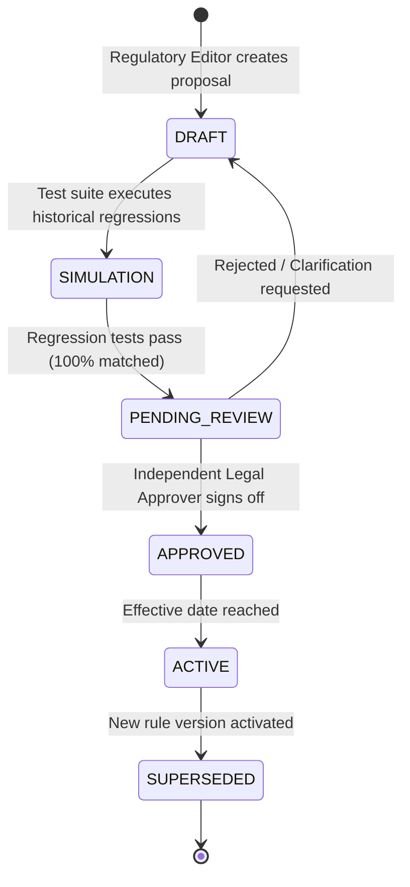

# ZimComply AI — Statutory Rule Governance & Lifecycle Specification

*Document Version:* 1.0.0  
*Phase:* Phase 0 Architecture Baseline  
*Status:* Authoritative

---

## 1. Governance Principles

1. **Deterministic Single Source of Truth:** All statutory rates, thresholds, deadlines, and formulas reside in database tables (`rule_packs` and `rule_versions`), never hardcoded in PHP or React source files.
2. **Absolute Prohibition of AI Calculation:** Generative AI models are strictly prohibited from performing mathematical calculations, deriving statutory tax liabilities, or declaring compliance statuses. Calculations are performed solely by deterministic, unit-tested PHP evaluators.
3. **Effective Date Immutability:** Any change in rates (e.g., a new Finance Act altering PAYE tax bands or NSSA insurable earnings caps) generates a new `rule_versions` record with an explicit `effective_from` date. Finalized past filings are permanently locked against historical retroactive alteration.
4. **Separation of Duties:** Modifying or activating a statutory rule pack requires dual-key authorization: a Regulatory Editor proposes the change, and an Independent Legal Approver verifies the gazetted citation before activation.

---

## 2. Rule Lifecycle State Machine



### 2.1 State Definitions
- **`DRAFT`**: Rule version authored with citation and parameters; accessible only in regulatory staging environments.
- **`SIMULATION`**: Automated testing runs benchmark test suites comparing new rules against expected calculation matrices.
- **`PENDING_REVIEW`**: Ready for legal audit. A diff of all thresholds, rates, and citations is rendered for the approver.
- **`APPROVED`**: Formally signed off by an authorized legal officer with timestamp and user ID.
- **`ACTIVE`**: The current authoritative rule set applied by the engine for dates falling within `[effective_from, effective_to]`.
- **`SUPERSEDED`**: Replaced by a subsequent gazetted version. Retained indefinitely for historical audits.

---

## 3. Dual-Currency & Financial Precision Standards

Zimbabwe operates an official multi-currency regime with the Zimbabwe Gold (ZiG) and the United States Dollar (USD). The rule engine enforces strict arithmetic rules:

### 3.1 Currency Storage & Precision
- **Database Types:** All monetary amounts are stored as `DECIMAL(18, 4)` in PostgreSQL. Never use floating-point types (`FLOAT`, `DOUBLE`).
- **PHP Handling:** High-precision math operations use PHP's `bcmath` extension (`bcadd`, `bcsub`, `bcmul`, `bcdiv`) with 4 decimal places of internal precision, rounded to 2 decimal places for user display.
- **Zero Currency Mingling:** Calculations for USD and ZiG are strictly isolated. The system never adds a USD amount to a ZiG amount without an explicit, timestamped exchange rate transaction record.

### 3.2 Dual-Currency Payroll Processing
- Employers paying mixed wages (e.g., 50% USD and 50% ZiG) must generate dual-column statutory returns.
- The rule engine evaluates:
  1. Statutory USD obligations against the USD tax tables and caps.
  2. Statutory ZiG obligations against the ZiG tax tables and caps.
  3. Blended returns format outputs according to official ZIMRA P2 and NSSA P4 dual-currency schedules.

---

## 4. Parameterized Rule Pack Schema

Every rule version stores its dynamic statutory parameters in a validated JSON schema.

### 4.1 Example: NSSA POBS Parameter Schema
```json
{
  "scheme_code": "NSSA_POBS",
  "employee_contribution_rate": 0.045,
  "employer_contribution_rate": 0.045,
  "insurable_earnings_ceiling": {
    "USD": 700.00,
    "ZiG": 18500.00
  },
  "max_monthly_contribution": {
    "USD": 31.50,
    "ZiG": 832.50
  },
  "statutory_citation": "SI 393 of 1993 & NSSA Notice 02/2026",
  "due_day_of_month": 10
}
```

### 4.2 Example: ZIMRA PAYE Progressive Brackets Schema
```json
{
  "currency": "USD",
  "tax_year": 2026,
  "frequency": "MONTHLY",
  "aids_levy_rate": 0.03,
  "brackets": [
    {"from": 0.00, "to": 100.00, "rate": 0.00, "deduct": 0.00},
    {"from": 100.01, "to": 300.00, "rate": 0.20, "deduct": 20.00},
    {"from": 300.01, "to": 1000.00, "rate": 0.25, "deduct": 35.00},
    {"from": 1000.01, "to": 2000.00, "rate": 0.30, "deduct": 85.00},
    {"from": 2000.01, "to": 3000.00, "rate": 0.35, "deduct": 185.00},
    {"from": 3000.01, "to": null, "rate": 0.40, "deduct": 335.00}
  ],
  "statutory_citation": "Finance Act 2024 / Gazetted Tables"
}
```

---

## 5. Regulatory Change Proposal Workflow (Module M12)

When an official statutory notice or gazette is published:

1. **Ingestion & Drafting:**
   - The notice text is uploaded or fetched into the `regulatory_change_proposals` table.
   - The AI assistant assists in drafting the proposed JSON parameter modifications and extracts the citation.
2. **Impact Simulation:**
   - The engine runs the proposed parameters against anonymized historical benchmark tenant data.
   - It outputs an **Impact Analysis Report**: average % variance in PAYE/NSSA liability, affected employee grades, and anticipated employer cash flow impact.
3. **Legal Audit & Sign-off:**
   - The accredited legal officer reviews the gazette citation, verifies the simulation delta, and digitally signs the approval.
4. **Automated Tenant Notifications:**
   - Once activated, all tenants affected by the changed statutory rule receive an automated compliance bulletin explaining what changed, why, and the effective date.
